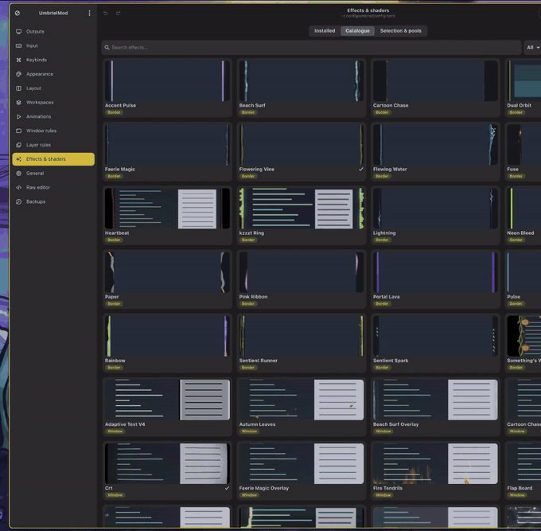
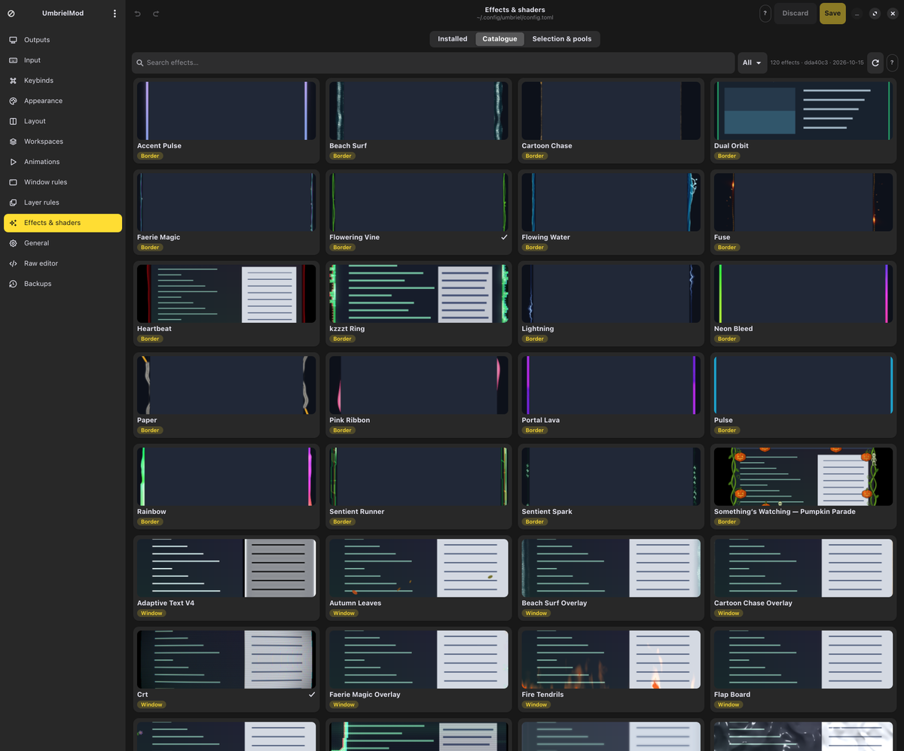
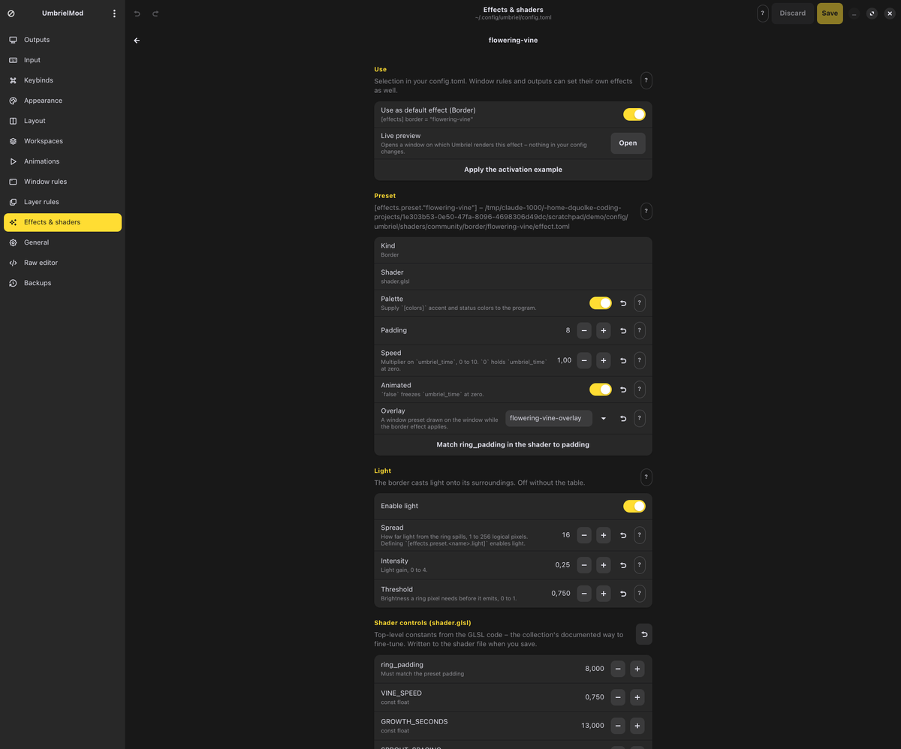
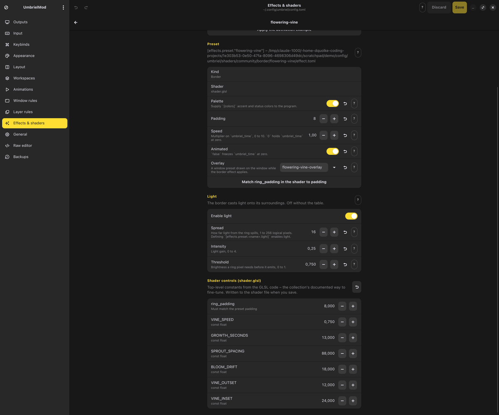
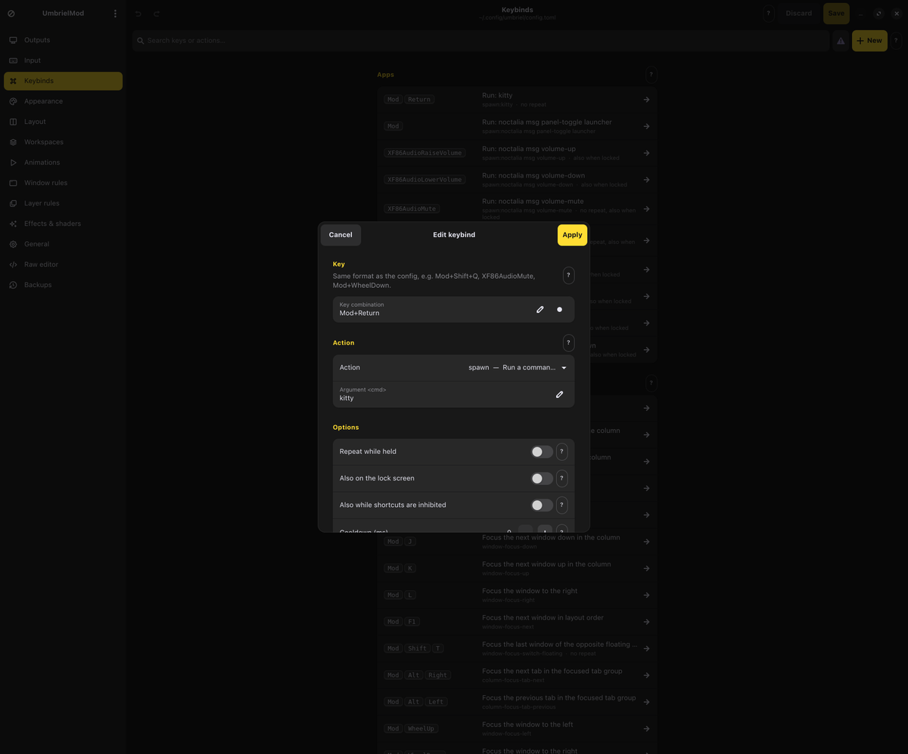
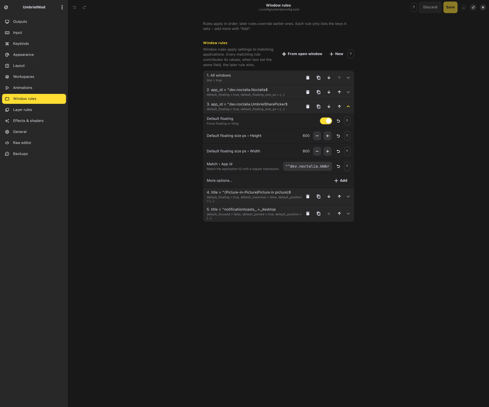
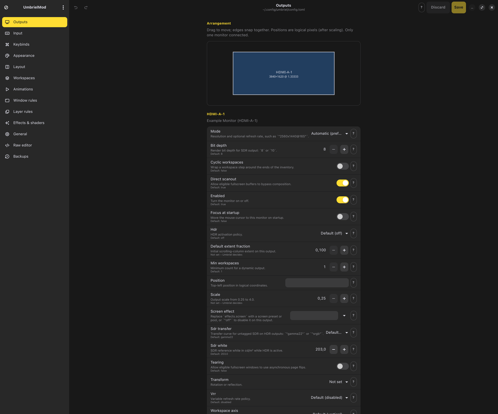

<div align="center">
  
  <h1>UmbrielMod</h1>

  **GTK4/libadwaita configuration editor for the [Umbriel](https://github.com/noctalia-dev/umbriel) Wayland compositor.**

  [](LICENSE)
  [](https://python.org)
  [](https://gtk.org)
  [](https://github.com/dMopp/umbrielmod/releases)
  [](https://github.com/dMopp/umbrielmod/actions/workflows/ci.yml)
</div>

Umbriel is configured with a single TOML file. UmbrielMod puts a native
interface on top of it — inspired by [NiriMod](https://github.com/srinivasr/nirimod) —
without taking the file away from you: comments, ordering and formatting survive
every edit.

Available in **English** and **German**; more languages can be added without
touching the code (see [Translations](#translations)).

<p align="center">
  
  <br>
  <sub><b>Live preview</b> – the effect is rendered by Umbriel itself on a preview window, nothing in your config changes
  (<a href="media/live-preview.webm">WebM</a>)</sub>
</p>

## Every option, straight from Umbriel

UmbrielMod does not hard-code a list of settings. At start-up it asks the
installed compositor for its schema (`umbriel config schema --json`) and builds
the pages from it, so **every option your Umbriel build accepts is editable** —
with the right control for its type, range, allowed values and default — and
options added in future Umbriel versions show up automatically.

Descriptions come from Umbriel's own documentation (`docs/user/*.md` in the
Umbriel repository). A copy is bundled; *Menu → Update schema and descriptions*
fetches the docs for the exact revision you have installed.

Every option, group and page has a round **(?)** button that opens the most
specific section of the [Umbriel documentation](https://docs.noctalia.dev/umbriel/)
for it — e.g. `output.tearing` opens
[`outputs/?section=tearing#tearing`](https://docs.noctalia.dev/umbriel/outputs/?section=tearing#tearing).

## Looks like Noctalia

UmbrielMod follows the [Noctalia](https://github.com/noctalia-dev/noctalia) shell:

- colours come from the active Noctalia palette (`~/.config/gtk-4.0/noctalia.css`,
  generated by Noctalia's GTK template) and update live when the palette or
  wallpaper changes,
- radii, spacing and control sizes follow Noctalia's style tokens,
- sidebar icons use Noctalia's bundled Tabler icon font.

Without Noctalia the regular libadwaita look is used.

## Screenshots

| | |
| --- | --- |
|  |  |
| **Shader catalogue** – 120 community effects with previews, install with one click | **Tune a preset** – only the keys Umbriel supports, plus live preview |
|  |  |
| **Shader controls** – the GLSL constants the collection documents for fine-tuning | **Keybinds** – key capture, action picker from `umbriel msg --help`, conflict detection |
|  |  |
| **Window rules** – only the keys a rule sets, more from a searchable list | **Outputs** – arrangement, modes and every output option, each with a (?) link to the docs |

## Features

- **Outputs** – drag-and-drop arrangement with edge snapping, modes detected via
  `umbriel outputs`, scale, VRR, HDR, SDR white level and every other output key.
- **Keybinds** – grouped by action category, search, conflict detection
  (modifier order and spelling are normalised, submaps respected), key capture
  that temporarily inhibits compositor shortcuts, action picker built from
  `umbriel msg --help` including argument hints.
- **Window rules, layer rules, workspaces, scratchpads, devices** – each entry
  shows only the keys it sets; add more from a searchable list, reorder,
  duplicate, or create a rule from a currently open window.
- **Effects & shaders** – browse the
  [community shader collection](https://github.com/noctalia-dev/community-umbriel-shaders)
  with previews, install effects (including companion overlays and licence
  files), apply their activation examples, and tune them. Effects from the
  catalogue may only define effects: one that sets anything else (keybinds,
  autostart, …) or points outside the collection is not offered:
  - only the preset keys Umbriel supports for that kind (`palette`; borders:
    `padding`, `speed`, `animated`, `overlay`, `light`; cursors: `radius`),
  - selection as default border/window/screen/cursor effect or per animation event,
  - top-level `#define`/`const` values in the GLSL source (the collection's
    documented way to fine-tune), with colour pickers for colour vectors and
    one-click restore of the original shader,
  - **live preview** in its own window, rendered by Umbriel: border and window
    effects on the preview window only, screen and cursor effects while it is
    open, animations played on demand (open/close a window, switch workspace,
    move a window). Effects that are not installed yet are loaded through a
    temporary copy of your saved config, which is restored when the preview
    closes.
- **Raw editor** for any loaded file, **undo/redo**, and a backup browser.

## Configuration safety

- Before anything is written, the complete configuration — including all
  `include`d files, with your pending changes applied — is copied to a scratch
  directory and checked with `umbriel config validate`. Invalid configurations
  are not saved; Umbriel's diagnostics are shown instead.
- Files are replaced atomically; the previous version goes to
  `~/.local/state/umbrielmod/backups/` (50 per file).
- Without a `~/.config/umbriel/config.toml`, UmbrielMod starts from the file
  Umbriel falls back to (`/etc/xdg`, then the packaged one), so the first save
  keeps your defaults instead of replacing them with only the changed options.
- A file with a TOML syntax error is never overwritten; fix it first.
- Values defined in included files (for example colours managed by Noctalia in
  `noctalia.toml`) are shown read-only with their source.
- External edits (scripts, your editor) are detected and reloaded.
- Umbriel watches its config, so saved changes apply immediately.

## Installation

```bash
curl -sSL https://raw.githubusercontent.com/dMopp/umbrielmod/main/install.sh | bash
```

The installer checks for Python, PyGObject, pycairo, GTK 4, libadwaita and git
(and offers to install them with apt, pacman, dnf, zypper, emerge or xbps),
installs
the **latest release** into an isolated environment made with
[uv](https://docs.astral.sh/uv/) in `~/.local/share/umbrielmod`, and adds
`umbrielmod` to `~/.local/bin` plus a desktop entry.

**Updates are automatic:** on start (and every six hours) UmbrielMod checks
GitHub in the background – one `git ls-remote`, no start-up delay. When a newer
[release](https://github.com/dMopp/umbrielmod/releases) exists it runs that
version's installer itself and then offers a restart. Turn this off under
*Menu → Update automatically*, check manually with *Menu → Check for updates*,
or set `UMBRIELMOD_NO_UPDATE=1`. Only installations made by the installer update
themselves; source checkouts never do.

Installer options: `--install` (non-interactive), `--uninstall`, `--skip-deps`,
`--version X.Y.Z` (a specific release), `--branch main` (follow the development
branch instead of releases – updates then track every commit).

What changed between versions: [CHANGELOG.md](CHANGELOG.md).

### NixOS

The installer above does not apply to NixOS; use the flake. It builds a
wrapped package with GTK 4, libadwaita and git, plus desktop entry and icon:

```bash
nix run github:dMopp/umbrielmod            # try it
nix profile install github:dMopp/umbrielmod
```

or in a flake-based configuration:

```nix
inputs.umbrielmod.url = "github:dMopp/umbrielmod";
# …
environment.systemPackages = [ inputs.umbrielmod.packages.${pkgs.system}.default ];
```

An overlay is available as `umbrielmod.overlays.default`. Nix installations do
not update themselves; update with `nix profile upgrade` or `nix flake update`.
`umbriel` still has to be on `PATH`, and Noctalia's icon font is found through
`XDG_DATA_DIRS` or next to the `noctalia` binary.

A `config.toml` generated by Home Manager or hjem (`programs.umbriel.settings`)
is a read-only link into the Nix store. UmbrielMod shows it but cannot save it;
keep a writable `~/.config/umbriel/config.toml` to edit it here.

### Requirements

- Umbriel on `PATH` (for the schema, validation and live preview)
- Any distribution Umbriel is packaged for works: Arch, Fedora, openSUSE
  Tumbleweed/Slowroll, Debian Trixie or newer, Ubuntu 26.04 or newer, NixOS
- Python 3.12+, PyGObject with pycairo, GTK ≥ 4.12, libadwaita ≥ 1.7
- git (for the shader catalogue)

### From source

```bash
git clone https://github.com/dMopp/umbrielmod
cd umbrielmod
uv venv --system-site-packages
uv sync
uv run umbrielmod            # or: uv run umbrielmod -c /path/to/config.toml
uv run pytest
```

On NixOS, `nix develop` provides Python with PyGObject, GTK 4, libadwaita,
tomlkit and pytest; run `python -m umbrielmod` and `pytest` there.

Regenerate the bundled option descriptions from an Umbriel checkout:

```bash
uv run python -m umbrielmod.docs /path/to/umbriel -v
```

## Translations

Translations are plain gettext `.po` files, read directly at runtime (no
compile step), so they can be edited with Poedit, Weblate or any text editor.
**[docs/TRANSLATING.md](docs/TRANSLATING.md)** walks through adding a language
step by step.

| Location | Purpose |
| --- | --- |
| `umbrielmod/locale/<lang>.po` | languages shipped with UmbrielMod |
| `~/.local/share/umbrielmod/locale/<lang>.po` | your own languages or fixes |
| `$UMBRIELMOD_LOCALE_DIR` (`:`-separated) | additional directories |

Later locations override earlier ones entry by entry, so a single corrected
string is enough to fix a translation. New files show up under *Menu → Language*
(their name comes from the `Language-Team` header).

To start a new language, copy `umbrielmod/locale/umbrielmod.pot` to e.g.
`fr.po`, set `"Language-Team: Français\n"` and fill in the `msgstr` lines.
Option descriptions from the Umbriel docs are included (marked `umbriel-docs:`)
and fall back to English when untranslated.

The language follows *Menu → Language*, `--lang`, `$UMBRIELMOD_LANG`, or the
usual `LANGUAGE`/`LC_ALL`/`LANG` variables. Maintainers refresh the template
and catalogues with:

```bash
uv run python -m umbrielmod.i18n extract   # update umbrielmod.pot
uv run python -m umbrielmod.i18n update    # merge into every shipped .po
uv run python -m umbrielmod.i18n stats     # coverage
```

## Contributing

Pull requests target `main`; see [CONTRIBUTING.md](CONTRIBUTING.md) for the
development setup, the changelog convention and how releases are made.

## Licence

MIT. Shaders installed from the community collection keep their own licences;
UmbrielMod copies each effect's licence file next to it.

*UmbrielMod is an independent project and not affiliated with the Umbriel or Noctalia teams.*

<sub>Developed with the help of Claude (Anthropic).</sub>
